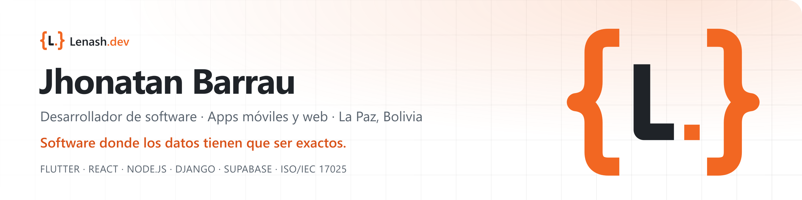
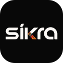
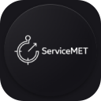
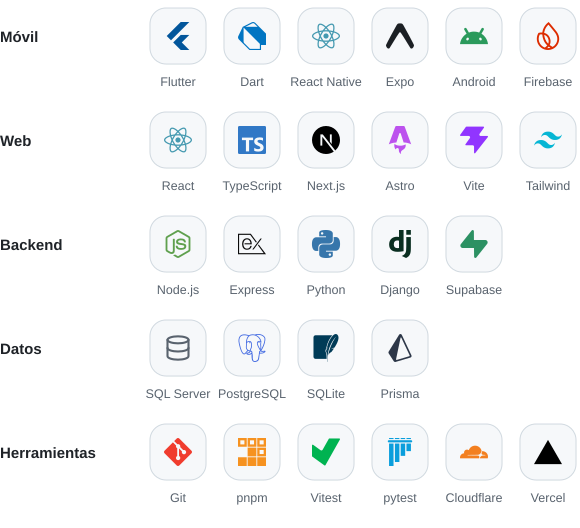

<picture>
  <source media="(prefers-color-scheme: dark)" srcset="assets/banner-dark.png">
  
</picture>

  <a href="https://lenash.dev"><b>lenash.dev</b></a> ·
  <a href="https://www.linkedin.com/in/jhonatan-barrau-farfan-b5688a444/">LinkedIn</a> ·
  <a href="mailto:contacto@lenash.dev">contacto@lenash.dev</a> ·
  <a href="https://lenash.dev/CV-Jhonatan-Barrau-Farfan.pdf">CV en PDF</a>

## Hola, soy Jhonatan

Desarrollador de software en La Paz, Bolivia. Construyo aplicaciones móviles y web para operaciones donde los datos tienen que ser exactos: apps que trabajan sin señal en planta, sistemas con trazabilidad **NB/ISO/IEC 17025** y productos que hoy usan laboratorios, empresas y academias.

- Trabajo en el **Área de Sistemas de Métrica Ltda.**, empresa de metrología y sistemas de pesaje.
- Como freelancer creé un **LIMS** que cumple la NB/ISO/IEC 17025 y **SIKRA**, un sistema para academias de danza. Además de programar, bailo.
- Me especializo en apps *offline-first*, trazabilidad, control de cambios y cálculos metrológicos.

## Soluciones

  
  

| | Proyecto | Qué es | Stack |
| :---: | --- | --- | --- |
|  | **[LIMS](https://lenash.dev/proyectos/lims)** | Sistema de gestión para laboratorios a medida. Cumple toda la NB/ISO/IEC 17025; LABSIC SRL, el primer laboratorio en usarlo, superó con él sus auditorías internas y externas. | Django · React · PostgreSQL |
|  | **[SIKRA](https://lenash.dev/proyectos/sikra)** | Sistema de gestión para academias de danza: elencos, asistencia, mensualidades y vestuario. En producción en Abdefol Expresiones Gemelas. | React Native · Flutter · Supabase |
|  | **[Qumt'asim](https://lenash.dev/proyectos/qumtasim)** | Sitio web y sistema de gestión para un restaurante: menú del día, reservas y convenios con empresas. | Next.js · Supabase |

## En Métrica Ltda. 

| | Proyecto | Qué es | Stack |
| :---: | --- | --- | --- |
|  | **[ServiceMET](https://lenash.dev/proyectos/servicemet)** | App de campo para Calibración y Soporte Técnico: funciona sin señal, lee el indicador por cámara y sube cada servicio validado al servidor. | Flutter · Node.js · SQL Server |
|  | **[IvMET](https://lenash.dev/proyectos/ivmet)** | Plataforma multiempresa de verificaciones intermedias de balanzas, con motor metrológico en el servidor y 7 días de trabajo sin conexión. | Flutter · Supabase |
| | **[DataMET+](https://lenash.dev/proyectos/datamet-plus)** | Aplicación web interna: recepción de instrumentos, cronogramas y plan anual de calibración con trazabilidad ISO/IEC 17025. | React · Express · SQL Server |
| | **[Sitio web](https://lenash.dev/proyectos/metrica-web)** | Sitio corporativo con catálogo, cotizador, demos 3D y un asesor virtual con IA. | Next.js · Three.js |

> Los repositorios de clientes y de la empresa son privados. Las capturas y el detalle técnico de cada proyecto están en **[lenash.dev](https://lenash.dev)**.

## Stack

<picture>
  <source media="(prefers-color-scheme: dark)" srcset="assets/stack-dark.svg">
  
</picture>

## Contacto

¿Tu laboratorio, empresa o academia necesita un sistema a medida? Escríbeme a **[contacto@lenash.dev](mailto:contacto@lenash.dev)** o por **[WhatsApp](https://wa.me/59176414647)**.

DESARROLLO · SOLUCIONES · IMPACTO

